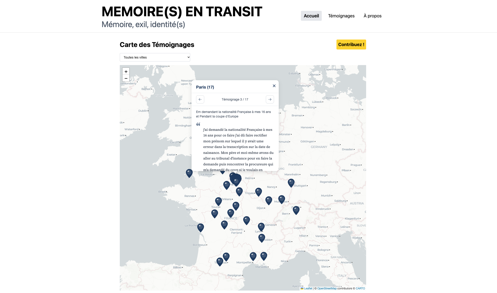

# MEMOIRES EN TRANSIT

Le projet de cartographier des mémoires éparses et multiples autour de l'immigration portugaise. Qu'ont ces lieux à nous dire ?

Un projet a été lancé par l'association Mémoire Vive en 2020 [Appel pour une collecte de témoignages sur le racisme anti-portugais en France](https://www.memoria-viva.fr/mv2-archives/?p=2399).

Les témoignages utilisés ici proviennent de cette récolte.





## Stack technique

Ce projet a fait l'object d'un premier test avec un [front en react](https://github.com/asso-memoire-vive/memoires-en-transit) et une [api en python](https://github.com/annemarie35/memoires-en-transit-api).
Ces projets n'ont pas été maintenus, ceci est une nouvelle occasion en testant d'abord cursor et puis Claude (Claude Opus 5.5) avec :

- Node
- React Next
- Vite
- Vitest

## Démarrage rapide

### 1. Lancer le front (Vite/React)

Placez-vous dans le dossier `memories` :

```bash
npm install
cp .env.example .env   # puis renseignez CARTO_API_KEY
npm run dev
```

En développement et en test, le fond de carte utilise les tuiles CARTO, qui nécessitent une clé API depuis septembre 2026.

Une clé gratuite peut être obtenue sur [carto.com/basemaps/apikey](https://carto.com/basemaps/apikey), sans compte CARTO.

En production, la carte utilise les tuiles [OpenStreetMap](https://tile.openstreetmap.org)


## Ressources

- https://www.memoria-viva.fr/category/les-projets/les-deserteurs-des-guerres-coloniales-portugaises-1961-1975/
- http://www.sudexpress.org/
- https://ecosexilios-cria.org/fr/
